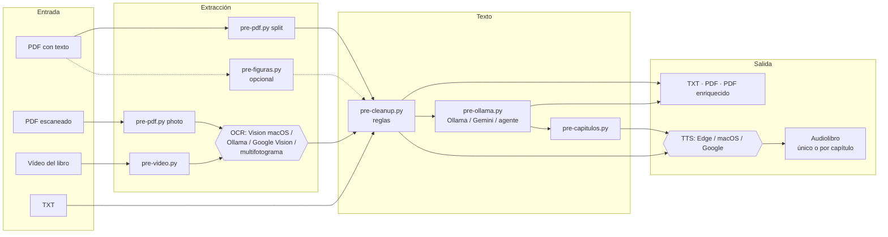

# audIAble

**De un PDF, un escaneo o un vídeo del libro grabado con el móvil, a texto limpio, PDF buscable y audiolibro.**

audIAble es un pipeline local (pensado para macOS, aunque la mayoría de los pasos corren en cualquier sistema) que
extrae el texto de un libro, lo limpia con reglas deterministas, opcionalmente lo corrige con un LLM (local con
Ollama, Gemini en Vertex AI o una CLI de agente que mira la imagen de cada página) y lo convierte en voz con uno de
tres motores de síntesis. Se maneja desde una interfaz de Streamlit (`app.py`) o paso a paso desde la línea de
comandos: cada etapa es un script independiente de `pasos/` con la misma convención `--f` (entrada) / `--o` (salida).

## Funciones principales

- **Entradas**: PDF con capa de texto, PDF escaneado (render + OCR), TXT ya extraído, carpeta completa, o **vídeo del
  libro** (uno o varios segmentos) del que se detecta una imagen por página.
- **OCR** con tres motores intercambiables: Vision de macOS (local, gratis), un modelo de visión en Ollama (local) o
  Google Cloud Vision (nube, franquicia mensual gratuita). Para vídeo, **OCR multifotograma**: lee todas las capturas
  de cada página y fusiona las lecturas renglón a renglón.
- **Limpieza determinista** pensada para TTS: folios y cornisas, palabras partidas, incisos, abreviaturas por idioma
  (español e inglés), saltos de línea con significado (títulos, citas, atribuciones) rematados con punto para que la
  voz haga la pausa.
- **Corrección con LLM** con guardarraíles anti-alucinación (longitud, palabras conservadas y nuevas), informe de
  cambios por página y, con agentes, injerto del borrador del OCR en los tramos marcados `[ilegible]`.
- **Detección de capítulos** (reglas + LLM opcional) para generar un audio por división.
- **Exportación**: TXT, PDF solo texto y **PDF enriquecido** (la página original como imagen con el texto limpio en una
  capa invisible, buscable y copiable).
- **Síntesis de voz** con Microsoft Edge TTS (gratis, en línea), `say` de macOS (gratis, sin red) o Google Cloud
  Text-to-Speech (de pago por carácter). Las etapas son reanudables: saltan lo que ya existe.
- **Estimación previa** de tiempo y coste por etapa, y progreso en vivo durante la ejecución.
- **Automatización desde el teléfono**: copia por USB (`adb`) las grabaciones recientes y las agrupa en libros sin
  intervención.

## Arquitectura en breve



La interfaz (`app.py`) no reimplementa nada: lanza estos mismos scripts como subprocesos y lee su salida para mostrar
el progreso. Detalle completo en [docs/ARCHITECTURE.md](docs/ARCHITECTURE.md).

## Inicio rápido

### Requisitos

- Python 3.9 o superior (el entorno del repo usa 3.9). macOS para el OCR de Vision, la voz `say` y la detección de
  página con Vision en vídeo (los scripts `.swift` se ejecutan con el `swift` de las Command Line Tools).
- Opcionales según el paso: [Ollama](https://ollama.com) con algún modelo descargado; credenciales de Google Cloud
  para Vision, Text-to-Speech o Gemini; `adb` para traer vídeos del teléfono; las CLI `claude`, `codex`, `agy` o
  `gemini` si se usan como correctores.

### Instalación

```bash
git clone https://github.com/Lapeyus/audIAble.git && cd audIAble
python3 -m venv .venv && source .venv/bin/activate
pip install -r requirements.txt
python3 -c "import nltk; nltk.download('punkt')"
```

### Interfaz gráfica (forma recomendada)

```bash
streamlit run app.py
# otro puerto o sin abrir el navegador:
streamlit run app.py --server.port 8555 --server.headless true
```

Se abre en http://localhost:8501. La página guía en ocho secciones: **1** qué procesar (archivo, vídeo o carpeta, e
idioma del libro), **2** OCR, **3** limpieza, **4** formatos del texto limpio, **5** voz (con muestra audible),
**6** formato del audio (un archivo o uno por capítulo), **7** estimación de tiempo y coste, **8** ejecutar. El
límite de subida está en 8 GB (`.streamlit/config.toml`) porque un vídeo del libro pesa cientos de MB; escribir la
ruta del archivo evita la copia.

### Línea de comandos

```bash
# PDF con capa de texto -> limpieza -> corrección -> capítulos -> voz
python3 pasos/pre-pdf.py      --f libro.pdf --o cap1 --m split --p 1-58
python3 pasos/pre-cleanup.py  --f cap1
python3 pasos/pre-ollama.py   --f cap1
python3 pasos/pre-capitulos.py --f cap1
python3 pasos/pro-edge-tts.py --f cap1 --o cap1/audio --v es-MX-DaliaNeural

# PDF escaneado: render de páginas + OCR de macOS
python3 pasos/pre-pdf.py     --f libro.pdf --o cap1/img --m photo --dpi 300
python3 pasos/pro-mac-ocr.py --f cap1/img --o cap1/ocr --idioma es

# Vídeo del libro abierto (dos páginas por toma), con capturas para el OCR multifotograma
python3 pasos/pre-video.py         --f grabacion/ --o cap1/img --doble --guardar-capturas
python3 pasos/pro-multiframe-ocr.py --f cap1/img --o cap1/texto --idioma es
python3 pasos/pre-cleanup.py       --f cap1/texto
```

El motor de voz se cambia sustituyendo el último paso por `pro-mac-tts.py` o `pro-gcp-tts.py`; todos aceptan
`--dryrun` para ver qué se generaría (el de Google estima el coste). La referencia completa de cada script y sus
argumentos está en [docs/SPEC.md](docs/SPEC.md#5-contratos-e-interfaces).

### Elegir una voz

```bash
python3 pasos/pro-edge-tts.py --voices | grep es-
python3 pasos/pro-mac-tts.py  --voices | grep es_
python3 utiles/demo-voices.py --e edge --l es-MX,es-ES,en-US   # una muestra por voz + demo unida
```

`utiles/demo-voices.py` deja `demos/demo_<motor>.<ext>` y `demos/<motor>/<voz>.<ext>` (la carpeta `demos/` no se
versiona). En macOS, `MacTTS.voice: null` usa la voz de sistema de Contenido Hablado; es la única vía para usar una voz
Siri, y `pro-mac-tts.py --vsiri <id>` la fija solo durante una ejecución (ver
[ARCHITECTURE.md](docs/ARCHITECTURE.md#voces-siri-en-macos)).

## Estructura del repositorio

```
app.py                  interfaz de Streamlit; orquesta los scripts de pasos/ como subprocesos
config.json             voces, tarifas, umbrales, modelos, ritmos de estimación y rutas
requirements.txt        dependencias de todo el pipeline (cada script importa solo lo suyo)
.streamlit/config.toml  límite de subida de archivos (8 GB)
nucleo/                 módulos compartidos e importables
  limpieza.py             reglas deterministas de limpieza para TTS
  estimacion.py           medida del volumen y cálculo de tiempo y coste por etapa
  exportar.py             PDF solo texto y PDF enriquecido (imagen + capa de texto invisible)
  calidad_video.py        nitidez, movimiento compensado, recorte, enderezado, planitud, lomo, curvatura
  ocr_calidad.py          variantes fotométricas y consenso de líneas de OCR
  gcp.py                  cadena de credenciales de Google y contador de uso de Vision
  gemini.py               cliente de Gemini en Vertex AI
  ollama_local.py         autodetección de modelos instalados en Ollama
  agentes.py              CLI de agentes (claude, codex, agy, gemini) como correctores
  typesafe.py             cliente HTTP mínimo de la API de imágenes de TypeSafe (experimental)
  boveda.py               lectura de una clave desde Google Secret Manager vía gcloud (para el POC)
  rutas.py                biblioteca en disco externo o trabajo/ como respaldo
pasos/                  un script por etapa, todos con --f y --o
  pre-pdf.py              PDF -> un TXT por página (split) o una imagen por página (photo)
  pre-video.py            vídeo(s) del libro -> una imagen por página (+ capturas, calidad.json)
  pre-figuras.py          descripción de figuras y tablas con un LLM, insertada en el texto
  pre-cleanup.py          limpieza determinista en lote
  pre-ollama.py           corrección con Ollama, Gemini o una CLI de agente
  pre-capitulos.py        detección de capítulos -> divisiones.json
  pro-mac-ocr.py          OCR con Vision de macOS (vision_ocr.swift)
  pro-multiframe-ocr.py   OCR multifotograma con fusión renglón a renglón
  pro-ollama-ocr.py       OCR con un modelo de visión en Ollama
  pro-gcp-ocr.py          OCR con Google Cloud Vision
  pro-edge-tts.py         síntesis con Microsoft Edge TTS
  pro-mac-tts.py          síntesis con say de macOS
  pro-gcp-tts.py          síntesis con Google Cloud Text-to-Speech
  vision_ocr.swift        ayudante de OCR con el framework Vision
  vision_pagina.swift     localización de la página y orientación del texto con Vision
utiles/                 herramientas sueltas
  traer-videos.py         copia por USB (adb) los vídeos recientes del teléfono
  procesar-biblioteca.py  agrupa grabaciones en libros y los produce sin intervención
  indicadores-calidad.py  indicadores de calidad de un libro hecho desde vídeo
  comparar-multiframe.py  banco de pruebas: OCR de una imagen frente a multifotograma
  evaluar-calidad-ocr.py  evaluación sintética del OCR por consenso (CER)
  poc-typesafe.py         POC de la API de imágenes de TypeSafe
  demo-voices.py          muestras de todas las voces de Edge o macOS
  join.py, resumen.py     unir archivos de texto; resumen extractivo con NLTK (scripts heredados)
tests/                  pruebas automatizadas (unittest)
docs/                   arquitectura, especificación y pruebas
```

`output/`, `tmp/`, `trabajo/`, `demos/` y `credentials.json` están en `.gitignore`.

## Configuración

Todo lo ajustable vive en `config.json`, una sección por componente:

| Sección | Para qué |
| --- | --- |
| `VisionAPI` | pistas de idioma de Google Vision |
| `TextToSpeechAPI` | voz, audio y tarifas por tipo de voz de Google TTS |
| `EdgeTTS` / `MacTTS` | voz, velocidad, tono/formato, tamaño máximo por parte de audio |
| `OllamaCleanup` | servidor, modelo, tamaño de trozo y umbrales del corrector |
| `OllamaOCR` / `Figuras` | modelo y prompt del OCR local; modelo de visión para figuras |
| `GoogleLLM` | región, modelos Gemini y tarifas orientativas |
| `Agentes` | modelo por CLI, timeout y umbrales relajados del corrector con agentes |
| `Estimacion` | ritmos medidos (s/página, caracteres/s) y tarifas para la estimación |
| `Video` | parámetros por omisión del detector de páginas en vídeo |
| `Rutas` | carpeta de la biblioteca en disco externo y pausa máxima entre grabaciones de un mismo libro |

**Credenciales de Google** (solo para Vision, Text-to-Speech, Gemini y el contador de franquicia): se resuelven en
este orden (`nucleo/gcp.py`): llave JSON explícita (`--cred` o el campo de la interfaz) → variable
`GOOGLE_APPLICATION_CREDENTIALS` si apunta a un archivo que existe → `credentials.json` en la raíz del repo → ADC del
sistema (`gcloud auth application-default login`). `credentials.json` está en `.gitignore`; no se versiona ninguna
llave.

**Otras variables de entorno**: `TYPESAFE_API_KEY` y `TYPESAFE_URL` (solo el POC de TypeSafe y el filtro opcional
del OCR multifotograma).

**Biblioteca en disco externo**: los vídeos y sus salidas pesan decenas de GB. Si la carpeta de `Rutas.biblioteca`
existe (disco montado), `traer-videos.py` copia a `<biblioteca>/entrada/telefono/` y la interfaz propone
`<biblioteca>/salida/`; si no, todo cae en `trabajo/` (`nucleo/rutas.py`). Ajusta esa ruta a tu máquina.

## Pruebas

```bash
.venv/bin/python -m unittest discover -s tests -v
```

52 pruebas en cuatro suites, sin red ni credenciales (la del POC de TypeSafe levanta un servidor simulado en
`127.0.0.1`). Resultado y brechas en [docs/TESTING.md](docs/TESTING.md).

## Operación

No hay despliegue ni tareas programadas: todo corre bajo demanda en la máquina del usuario. Lo más parecido a un
servicio es `utiles/traer-videos.py --vigilar --procesar`, que se deja corriendo en una terminal y, al conectar el
teléfono por USB, copia las grabaciones nuevas y las convierte en libros (OCR, limpieza, TXT y PDF enriquecido). Ver
[ARCHITECTURE.md](docs/ARCHITECTURE.md#flujo-3-biblioteca-automática-desde-el-teléfono).

## Documentación

- [docs/ARCHITECTURE.md](docs/ARCHITECTURE.md): contexto, componentes, flujos, secuencias, despliegue, dependencias,
  decisiones y resultados de las mediciones.
- [docs/SPEC.md](docs/SPEC.md): requisitos funcionales y no funcionales, especificación por componente con criterios
  de aceptación, contratos CLI y formatos de archivo, trazabilidad.
- [docs/TESTING.md](docs/TESTING.md): estrategia, inventario de suites, cómo correrlas y brechas.

## Estado y limitaciones conocidas

- Proyecto personal en evolución; macOS es la plataforma de referencia. Fuera de Mac, el detector de vídeo usa una
  heurística (región clara más grande) que solo funciona sobre fondo oscuro y liso, y no hay OCR de Vision.
- Los ritmos de `Estimacion` están medidos en una sola máquina: recalíbralos en otra. El del LLM local es el más
  variable y domina el total.
- El OCR por consenso (`--calidad alta`) no redujo el error en la evaluación sintética y va desactivado por omisión.
- Gemini CLI se queda colgado al adjuntarle una imagen en la máquina de desarrollo: no está validado como corrector.
- No existe un corpus de vídeos reales con transcripción verificada para medir CER/WER; las pruebas son sintéticas.
- `utiles/join.py` y `utiles/resumen.py` son scripts heredados con rutas fijas y sin `argparse`.
- La API de imágenes de TypeSafe está en fase de prototipo; su uso aquí es experimental y va apagado por omisión.

## Licencia

GNU General Public License v3.0 (ver [LICENSE](LICENSE)).
