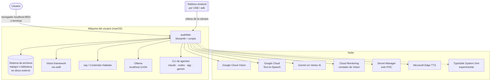
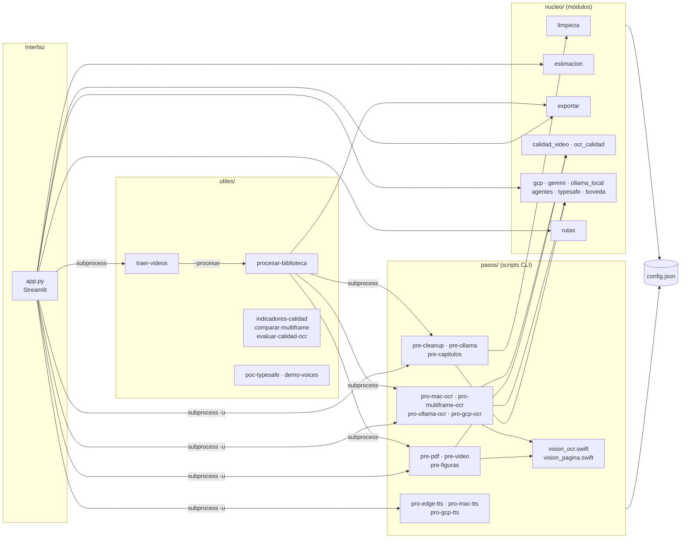
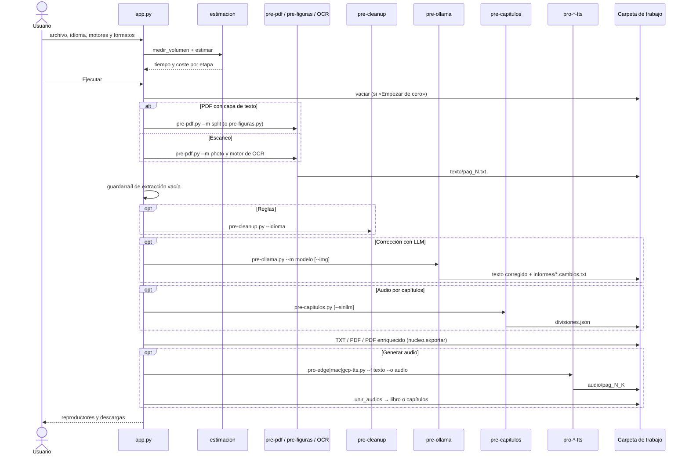
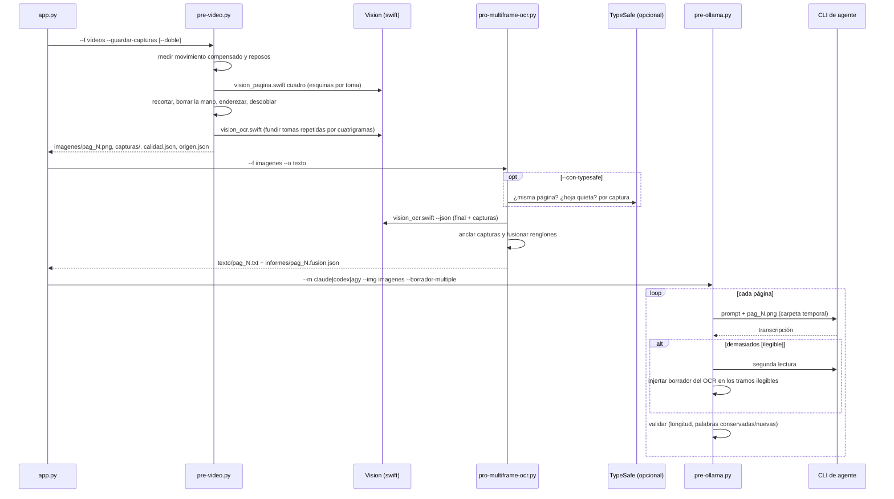
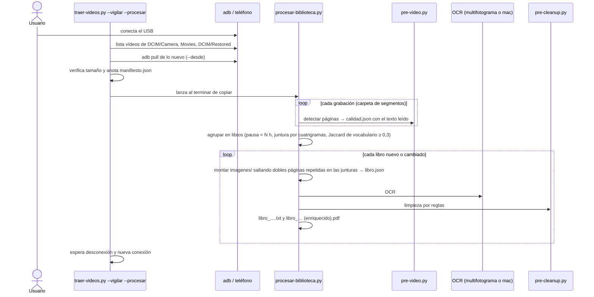
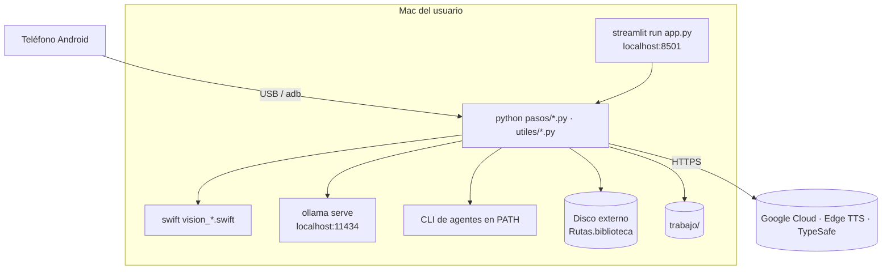

# Arquitectura de audIAble

Este documento describe cómo está construido audIAble: actores y sistemas externos, componentes, flujos de datos,
modelo de despliegue, dependencias y las decisiones de diseño que se ven en el código y en el historial. Todo sale del
código del repositorio; donde algo no se puede determinar, se indica.

## 1. Contexto

audIAble es una aplicación de escritorio para una sola persona. No tiene servidor propio, base de datos ni cuentas:
lee archivos locales, escribe archivos locales y, según las opciones elegidas, llama a servicios locales (Ollama,
frameworks de macOS) o en la nube (Google, Microsoft Edge TTS, TypeSafe).



| Actor / sistema | Papel | Obligatorio |
| --- | --- | --- |
| Usuario | elige entrada, motores y formatos; revisa la hoja de contactos de páginas detectadas | sí |
| Sistema de archivos | entrada, artefactos intermedios y finales; estado de reanudación | sí |
| Vision.framework (macOS) | OCR, localización de la página y orientación del texto en vídeo | no (recomendado en Mac) |
| `say` (macOS) | síntesis de voz local | no |
| Ollama | corrección de texto, OCR con modelos de visión, capítulos, descripción de figuras | no |
| CLI de agentes | corrección mirando la imagen de la página | no |
| Google Cloud Vision / TTS / Vertex AI | OCR, síntesis y corrección en la nube | no |
| Cloud Monitoring | lectura del uso mensual de Vision para descontar la franquicia gratuita | no |
| Microsoft Edge TTS | síntesis de voz gratuita en línea (paquete `edge-tts`) | no |
| Teléfono Android | origen de los vídeos del libro, vía `adb` | no |
| TypeSafe System One + Secret Manager | POC y filtro opcional de capturas | no (apagado por omisión) |

## 2. Contenedores y componentes



### Interfaz (`app.py`)

Página de Streamlit en ocho secciones (entrada, OCR, limpieza, formatos de texto, voz, formato de audio, estimación,
ejecución). Construye la lista de comandos según las opciones y ejecuta cada script con `subprocess.Popen` y salida
sin búfer, mostrando el registro en vivo y una barra de progreso por etapa: cuenta las líneas de salida que casan con
un patrón propio de cada script y proyecta el tiempo restante con el ritmo real de la corrida. Además:

- consulta en vivo voces de `say` y de Edge, modelos de Ollama y CLI de agentes instaladas, y la franquicia de Vision
  restante (Cloud Monitoring);
- calcula la estimación con `nucleo/estimacion.py` antes de ejecutar;
- aplica un guardarraíl tras la extracción: si salió prácticamente vacía, se detiene con la causa probable (PDF sin
  capa de texto, o vídeo mal iluminado/recortado);
- exporta TXT/PDF con `nucleo/exportar.py` y une las partes de audio en un archivo único o uno por división
  (`unir_audios`: WAV con 0,5 s de silencio entre partes; MP3 por concatenación de bytes);
- «Empezar de cero» vacía la carpeta de salida para que las etapas reanudables no hereden restos de otro libro.

### Scripts de `pasos/`

Cada etapa es un script independiente con `argparse`, ejecutable a mano y desde la interfaz. Convenciones comunes:
`--f` entrada, `--o` salida, páginas como `pag_N.txt` / `pag_N.png`, y omisión de lo que ya existe (reanudables). Los
informes van a una subcarpeta `informes/` para que el TTS nunca los lea como texto del libro.

| Prefijo | Significado |
| --- | --- |
| `pre-` | preparación: extracción, detección, limpieza, corrección, capítulos |
| `pro-` | procesamiento con un motor: OCR o síntesis de voz |

Los ayudantes Swift se ejecutan con `swift <script>` (intérprete de las Command Line Tools) y hablan por stdout con
un protocolo de líneas `###FILE:<ruta>` / `###ERROR:<motivo>`; `vision_ocr.swift --json` devuelve por imagen una lista
de renglones con texto, confianza y caja.

### Módulos de `nucleo/`

| Módulo | Responsabilidad |
| --- | --- |
| `limpieza.py` | reglas deterministas para TTS (ver [SPEC §4.4](SPEC.md#44-limpieza-determinista)) |
| `estimacion.py` | volumen real (páginas y caracteres del PDF, TXT o duración del vídeo) y tiempo/coste por etapa |
| `exportar.py` | PDF solo texto (A4, Helvetica 11, sin perder texto) y PDF enriquecido (página a ~150 dpi JPEG + capa invisible) |
| `calidad_video.py` | métricas y geometría de vídeo: nitidez Tenengrad, movimiento compensado, cuadriláteros seguros, enderezado, planitud, lomo, desdoblado de curvatura, iluminación; `VERSION` forma parte de la huella de reutilización |
| `ocr_calidad.py` | variantes fotométricas (iluminación uniformada, CLAHE) y consenso de líneas |
| `gcp.py` | cadena de credenciales de Google y uso mensual de Vision desde Cloud Monitoring |
| `gemini.py` | cliente `google-genai` sobre Vertex AI (razonamiento desactivado en modelos flash) |
| `ollama_local.py` | lista modelos de Ollama y elige el mejor candidato por tarea (texto, OCR, figuras) |
| `agentes.py` | invoca `claude`, `codex`, `agy` o `gemini` en modo no interactivo dentro de una carpeta temporal |
| `typesafe.py` | cliente multipart de TypeSafe System One (preparación de imágenes, reintentos con espera exponencial) |
| `boveda.py` | lee una clave desde Google Secret Manager con `gcloud` (solo para el POC) |
| `rutas.py` | biblioteca en disco externo si está montada; `trabajo/` como respaldo |

## 3. Flujos de datos

### Carpeta de trabajo de una corrida de la interfaz

```
<carpeta de salida>/
  imagenes/                 solo con OCR
    pag_N.png               una imagen por página (render del PDF o detectada en el vídeo)
    capturas/pag_N/cap_K.png  capturas alternativas de cada página (vídeo, --guardar-capturas)
    brutos/                 fotogramas enteros sin recortar (vídeo, --brutos)
    origen.json             huella del vídeo y ajustes, para reutilizar la detección
    calidad.json            informe por página del detector
    paginas_detectadas.jpg  hoja de contactos numerada
  texto/
    pag_N.txt               texto de cada página, limpiado y corregido en el sitio
    pag_N.ocr.json          lecturas alternativas del OCR por consenso (opcional)
    informes/pag_N.fusion.json, fusion_resumen.json, pag_N.cambios.txt
  audio/pag_N_K.(mp3|wav)   partes de audio de cada página
  divisiones.json           capítulos detectados (audio por división)
  <libro>.txt · <libro>.pdf · <libro> (enriquecido).pdf · <libro o capítulo>.(mp3|wav)
```

Los archivos finales llevan el nombre del archivo de entrada (o de la carpeta, o el prefijo común de los segmentos de
vídeo, saneado).

### Flujo 1: PDF o escaneo hasta audiolibro desde la interfaz



### Flujo 2: vídeo del libro con OCR multifotograma y corrector con agente

Es el flujo por omisión para vídeo en la interfaz y en `procesar-biblioteca.py` cuando el motor de OCR es el de macOS.



**Detector de páginas (`pre-video.py`)**, en orden:

1. Muestrea `--fps` fotogramas por segundo y mide el cambio entre consecutivos **después de alinearlos** (flujo óptico
   de ida y vuelta + ajuste afín robusto a 320 px, descontando cambios globales de exposición), para que el temblor de
   la mano no cuente como movimiento. Un pico es una vuelta de hoja; el reposo de al menos `--quietud` segundos entre
   picos, una página. El umbral es el mayor entre `--umbral` y `--factor` × el movimiento mediano del vídeo. Un pico
   breve en el que la nitidez se desploma (autoenfoque) no parte el reposo.
2. De cada reposo elige la referencia más nítida entre las **planas** (una hoja a medio pasar es nítida pero no
   plana) y guarda `--capturas` capturas adicionales del reposo y de su entorno inmediato.
3. Localiza la página con Vision (`vision_pagina.swift`, detector de documentos) fotograma a fotograma; valida las
   esquinas (`cuadro_seguro`: convexidad, ángulos, lados, área coherente con la mediana) y una toma sin esquinas
   fiables hereda las de la toma válida más cercana. Fuera de Mac usa la región clara más grande.
4. **Borra la mano**: detecta piel (YCrCb + HSV) y sustituye cada mancha por la mediana de las capturas donantes
   alineadas localmente (SIFT + RANSAC, afinado ECC). Exige dos donantes coincidentes o uno muy fiable, que los
   donantes se parezcan entre sí, y fuera de la caja del texto solo admite papel, para no duplicar finales de línea.
5. Endereza por el ángulo de las líneas, desdobla la curvatura junto al lomo (conservador) y uniformiza la iluminación.
6. Orienta el texto (Vision prueba las cuatro rotaciones) y **funde tomas repetidas** comparando su texto por
   cuatrigramas de caracteres (`--similitud`), o por correlación de imagen en páginas con poco texto.
7. Con `--doble` parte cada toma por el lomo en dos páginas. Escribe `pag_N.png`, `calidad.json`, la hoja de contactos
   y `origen.json` (huella de vídeos + ajustes + `calidad_video.VERSION`): si coincide en una corrida posterior,
   reutiliza las páginas en vez de repetir la detección.

**Fusión multifotograma (`pro-multiframe-ocr.py`)**: cada captura se ancla a la imagen final por al menos tres
renglones cuyo texto casi coincide (ratio ≥ 0,8) y se ajusta un desplazamiento y escala robustos (pendiente mediana);
sin anclas no aporta. Cada renglón de la imagen final abre un grupo; cada renglón de captura se une al grupo que mejor
le encaja, como mucho uno por captura; cada grupo se queda con la lectura más confiable. Un renglón ausente en la
imagen final solo se acepta si es fiable, largo o visto por dos capturas, y no está ya en otro sitio de la página.

### Flujo 3: biblioteca automática desde el teléfono



La corrección con LLM y el audio de esos libros se lanzan después desde la interfaz sobre su carpeta.

## 4. Modelo de despliegue

No hay despliegue en la nube ni tareas programadas (no hay launchd, cron, Dockerfile ni Terraform en el repo). Todo
corre en la máquina del usuario:



## 5. Dependencias externas y cuotas

| Dependencia | Uso | Coste / cuota según el código y `config.json` |
| --- | --- | --- |
| Google Cloud Vision (`google-cloud-vision`) | `pro-gcp-ocr.py` (`document_text_detection`, una petición por imagen) | 1.000 imágenes gratis al mes, luego 1,5 USD por 1.000 (`Estimacion`); el uso del mes se lee de Cloud Monitoring |
| Google Cloud Text-to-Speech | `pro-gcp-tts.py`, salida LINEAR16 | por carácter según tipo de voz (`TextToSpeechAPI.Pricing`) |
| Gemini en Vertex AI (`google-genai`) | corrección, capítulos, figuras | tarifas orientativas por 1.000 caracteres e imagen (`GoogleLLM`) |
| Microsoft Edge TTS (`edge-tts`) | `pro-edge-tts.py`, demos | gratis, requiere red; sin cuota documentada en el código |
| Ollama | corrección, OCR, capítulos, figuras | local; el rendimiento depende de la memoria (ver §7) |
| CLI de agentes | corrección con imagen | según la cuenta del usuario de cada CLI; no determinado en el código |
| TypeSafe System One | POC y filtro opcional | por tokens de entrada (~3.000 por imagen medidos en el POC) |
| PyMuPDF, OpenCV, NLTK, BeautifulSoup, Pillow, Streamlit | extracción, visión, tokenización, interfaz | librerías locales |

Límites técnicos aplicados en el código: partes de audio de menos de `max_bytes` (5.000 bytes) cortadas en párrafo,
frase o palabra; trozos de `chunk_chars` (1.800) para el LLM local y página entera para agentes; lotes de 40-200
imágenes por invocación de Vision; imágenes para TypeSafe entre 280 y 1.568 px.

## 6. Decisiones relevantes

- **Un script por etapa y la interfaz como orquestadora** (historial: «reorganize pipeline into pasos/ and utiles/»,
  «add Streamlit interface»). Todo lo que hace la interfaz se reproduce desde la terminal y cada etapa se prueba sola.
- **Etapas reanudables por existencia de archivo** y, en Edge y macOS, escritura atómica de cada parte de audio
  (archivo parcial renombrado al final): una corrida interrumpida se retoma sin repetir trabajo; por eso la interfaz vacía la carpeta por omisión.
- **Guardarraíles medibles para el LLM** en vez de confiar en el prompt: un modelo que reordena reutiliza palabras,
  uno que inventa trae las suyas; el trozo que excede los umbrales se descarta y se conserva el original.
- **Saltos de línea con significado**: si el renglón siguiente empieza en minúscula nunca hay corte; los títulos,
  citas y atribuciones se rematan con punto para que el TTS haga la pausa (commit «punctuate structural line breaks»).
- **Vision de macOS como OCR recomendado** en Mac: gratis, local y ~4 s por página, frente a ~280 s de un modelo de
  visión local medido en la máquina de desarrollo.
- **Multifotograma por omisión para vídeo y sin TypeSafe por omisión**: las mediciones (§7) mostraron una reducción
  robusta de `[ilegible]` con varias capturas, y ninguna ventaja clara del filtro de TypeSafe frente a su coste.
- **Reutilización de la detección por huella** (`origen.json` con la versión del algoritmo): la detección de un libro
  entero cuesta del orden de media hora; un cambio de algoritmo invalida la caché.
- **Consenso de OCR desactivado por omisión**: triplica el coste y no redujo el CER en la evaluación sintética.
- **Agentes en carpeta temporal**: la imagen se copia allí porque la sandbox de Codex no sale de su carpeta y un disco
  externo quedaría fuera; el agente solo puede leer lo que se le da.

### Voces Siri en macOS

`say` no puede abrir las voces de Siri: `say -v <nombre>` cae en otra voz y `say -v com.apple.siri…` falla con
`Open speech channel failed: -244`; `AVSpeechSynthesisVoice` tampoco las expone. La única vía es la voz de sistema de
Contenido Hablado, que `say` usa cuando se llama sin `-v`. Por eso `MacTTS.voice` es `null` y `--vsiri <id>` guarda
la preferencia actual, escribe la pedida, sintetiza sin `-v` y la restaura al terminar (también ante error o SIGTERM).
Advertencias: el cambio afecta a todo el sistema mientras dura; la preferencia está bajo TCC (si no se puede escribir,
el script aborta y hay que dar Acceso Total al Disco a la terminal); y no hay API para listar los identificadores: se
elige la voz una vez en Ajustes y se lee con
`defaults read com.apple.Accessibility SpokenContentDefaultVoiceSelectionsByLanguage`.

## 7. Mediciones registradas

Valores medidos por el autor en su máquina y registrados en la versión anterior del README; sirven de referencia, no
de garantía.

**Estimación sobre una novela de prueba de 58 páginas (341.921 caracteres)**:

| Configuración | Tiempo | Coste | Audio |
| --- | --- | --- | --- |
| Reglas + Edge | 32 min | gratis | 6 h 07 min |
| Reglas + LLM + Edge + capítulos | 14 h 20 min | gratis | 6 h 07 min |
| Reglas + LLM + macOS | 13 h 50 min | gratis | 6 h 07 min |
| OCR de Google + voz de Google | 34 min | 5,47 USD | 6 h 07 min |

La síntesis de macOS es unas seis veces más rápida que Edge (1.177 frente a 178 caracteres/s). El LLM local de 27B
dio 72 car/s en un fragmento suelto pero 6,9 car/s en una página completa por presión de memoria (valor calibrado);
Gemini Flash corrigió en 10 s una página que al modelo local le costó 839 s. En las pruebas del autor, un modelo de
9B dejó texto entrelazado sin resolver e inventó texto, mientras que el de 27B lo reconstruyó (~80 s por página).

**Correctores con agente** (libro de prueba de 116 páginas grabado en vídeo): Claude ~20 s por página, Codex ~6 s,
Antigravity ~75 s; Claude y Codex aceptaron todas las páginas.

**OCR de una imagen (A) frente a multifotograma (B)**, mismo libro, corrector Claude:

| Indicador | A · una imagen | B · multifotograma |
| --- | --- | --- |
| `[ilegible]` tras el agente | 214 | 32 |
| Páginas con algún `[ilegible]` | 35 | 10 |
| Renglones dudosos de Vision | 41 | 22 |
| Palabras sin respaldo en el OCR | 267 | 229 |

La fusión recuperó 130 renglones y mejoró 574. Repeticiones (el corrector no es determinista):

| Corrida | `[ilegible]` | Páginas con 10 o más | `[ilegible]` en el resto | Palabras sin respaldo |
| --- | --- | --- | --- | --- |
| A · 1 | 214 | 8 | 69 | 267 |
| A · 2 | 247 | 9 | 69 | 230 |
| B · 1 | 32 | 1 | 19 | 229 |
| B · 2 | 45 | 2 | 10 | 224 |
| D · B sin filtro TypeSafe | 80 | 3 | 24 | 208 |

Conclusión registrada: la ganancia del multifotograma es robusta; el filtro de TypeSafe no mostró ventaja clara (en
95 de 116 páginas el borrador con y sin filtro era idéntico) y costaba ~1,5 millones de tokens por libro, por lo que
va apagado (`--con-typesafe` lo activa). La varianza se explicaba sobre todo por páginas declaradas ilegibles
enteras, lo que motivó el guardarraíl de segunda lectura e injerto del borrador.

**POC de TypeSafe** (29 páginas etiquetadas a mano, 65 peticiones): `estado` 24/24, `mano` 24/24, `misma` 24/24 con
márgenes amplios, `box` IoU mediano 0,92 frente a Vision; latencia mediana 0,6 s, ~3.000 tokens por imagen. Box no
sustituye al recorte de Vision (caja alineada a los ejes, sin perspectiva). Muestra pequeña y API en prototipo.

**Candidatos no integrados** para páginas curvas: PP-OCRv5 y PaddleOCR-VL-1.5. Referencias usadas: homografías en
OpenCV, estimadores robustos USAC, tamaño mínimo de texto y confianza en `VNRecognizeTextRequest`.
