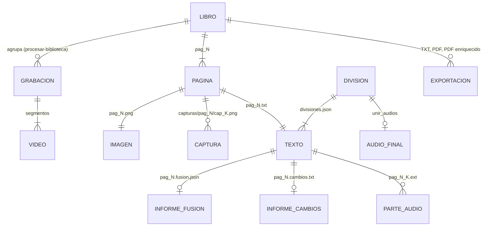

# Especificación de audIAble

Documento de *spec-driven development*: qué debe hacer el sistema, con qué reglas, cómo se verifica y qué contratos
expone. Describe el comportamiento implementado en el código actual; los criterios de aceptación con prueba
automatizada indican la suite que los cubre (ver [TESTING.md](TESTING.md)).

## 1. Propósito y alcance

**Propósito**: convertir un libro (PDF con texto, escaneo, TXT o vídeo grabado con el móvil) en texto limpio apto
para síntesis de voz, en PDF buscable y en audiolibro, con el menor coste posible y priorizando motores locales.

**Dentro del alcance**: extracción de texto y OCR, detección de páginas en vídeo, limpieza determinista, corrección
con LLM con guardarraíles, descripción de figuras y tablas, detección de capítulos, exportación TXT/PDF, síntesis con
tres motores, estimación de tiempo y coste, interfaz de Streamlit, automatización de la ingesta desde un teléfono
Android y herramientas de medición de calidad.

**Fuera del alcance**: multiusuario, servicio web público, almacenamiento en la nube, gestión de derechos de autor de
los libros procesados, y edición manual del texto dentro de la interfaz.

## 2. Requisitos funcionales

| ID | Requisito |
| --- | --- |
| RF-01 | Extraer el texto de un PDF con capa de texto, un TXT por página, en un rango de páginas opcional. |
| RF-02 | Renderizar páginas de un PDF a imagen a una resolución configurable (300 dpi por omisión). |
| RF-03 | Reconocer el texto de imágenes de página con al menos tres motores intercambiables: Vision de macOS, Ollama y Google Cloud Vision. |
| RF-04 | Convertir uno o varios vídeos de un libro en una imagen por página, fundiendo páginas repetidas, también entre segmentos. |
| RF-05 | Leer todas las capturas de cada página de vídeo y fusionar las lecturas para recuperar texto tapado o mal leído. |
| RF-06 | Limpiar el texto con reglas deterministas aptas para TTS, con tablas de abreviaturas en español e inglés. |
| RF-07 | Corregir el texto con un LLM local, Gemini o una CLI de agente, aceptando solo correcciones dentro de umbrales medibles. |
| RF-08 | Con un agente y la imagen de la página, limitar las marcas `[ilegible]` injustificadas y rellenarlas con el borrador del OCR. |
| RF-09 | Describir figuras y tablas con un LLM e insertar la descripción en el punto de lectura, en el idioma del libro. |
| RF-10 | Detectar capítulos y secciones y producir `divisiones.json`. |
| RF-11 | Exportar el texto limpio como TXT, PDF solo texto y PDF enriquecido, con el nombre del libro de entrada. |
| RF-12 | Sintetizar voz con Edge TTS, `say` de macOS o Google TTS, en partes reanudables, y unirlas en un audio único o uno por división. |
| RF-13 | Estimar antes de ejecutar el tiempo y el coste por etapa a partir del volumen real. |
| RF-14 | Ofrecer una interfaz gráfica que conduzca todo el pipeline y muestre el progreso en vivo. |
| RF-15 | Copiar por USB los vídeos recientes de un teléfono Android sin repetir copias, opcionalmente vigilando conexiones. |
| RF-16 | Agrupar grabaciones consecutivas en libros y producir TXT y PDF enriquecido sin intervención. |
| RF-17 | Medir indicadores de calidad de un libro hecho desde vídeo y comparar cadenas de OCR. |
| RF-18 | Listar voces y generar muestras audibles de cada voz disponible. |
| RF-19 | Resolver las credenciales de Google con una cadena de fuentes y pedir una llave solo si ninguna existe. |

## 3. Requisitos no funcionales

| ID | Requisito |
| --- | --- |
| RNF-01 Coste | Toda la cadena debe poder ejecutarse gratis (Vision/`say`/Edge/Ollama). Los motores de pago muestran su coste antes de ejecutar; Vision descuenta la franquicia mensual leída de Cloud Monitoring. |
| RNF-02 Reanudación | Cada etapa salta los archivos de salida que ya existen; la detección de vídeo se reutiliza si la huella coincide. Una interrupción no deja partes de audio truncadas en Edge y macOS. |
| RNF-03 Fidelidad | Ningún componente automático puede introducir texto no respaldado sin control: guardarraíles de palabras para el LLM, umbrales de confianza y anclas para la fusión, consenso con acuerdo de dos variantes. |
| RNF-04 Rendimiento | Los ritmos esperados por etapa están en `Estimacion` (por ejemplo, ~4 s por página con Vision, 178 car/s con Edge, 1.177 car/s con `say`) y deben recalibrarse por máquina. |
| RNF-05 Seguridad | Ninguna credencial se versiona (`credentials.json` en `.gitignore`); las claves leídas de una bóveda solo viven en memoria; los agentes corren en una carpeta temporal sin archivos del proyecto. |
| RNF-06 Privacidad | Los libros y vídeos se procesan localmente salvo que el usuario elija un motor en la nube; nada se sube por omisión. |
| RNF-07 Portabilidad | El pipeline de PDF/TXT, Ollama, Google y Edge funciona fuera de macOS; Vision, `say` y la localización de página por Vision requieren macOS. |
| RNF-08 Trazabilidad | Cada corrección deja `informes/pag_N.cambios.txt`; la fusión deja `pag_N.fusion.json`; el detector deja `calidad.json` y la hoja de contactos. |
| RNF-09 Disponibilidad | No aplica servicio continuo; si Ollama no responde, la detección de capítulos cae a reglas y la corrección se detiene con un mensaje accionable. |

## 4. Especificación por componente

### 4.1 Extracción de PDF (`pasos/pre-pdf.py`)

- **Entradas**: `--f` PDF, `--o` carpeta, `--m split|photo`, `--p` páginas (`1`, `1-5`, `2,7,9`), `--dpi`.
- **Salidas**: `pag_N.txt` (split) o `pag_N.png` (photo), con N la página real (1-based).
- **Reglas**: el texto se lee con PyMuPDF en orden de lectura.
- **Aceptación**: Dado un PDF de 10 páginas y `--p 2-3`, cuando se ejecuta en modo split, entonces existen
  exactamente `pag_2.txt` y `pag_3.txt`. Interpretación de rangos cubierta para `estimacion.parsear_paginas`
  (`test_logica_pura.EstimacionTest.test_parsear_paginas`).

### 4.2 Detector de páginas en vídeo (`pasos/pre-video.py`)

- **Entradas**: uno o varios vídeos o carpetas (`.mp4 .mov .m4v .avi .mkv .webm`), parámetros del detector (por
  omisión en `config.json › Video`).
- **Salidas**: `pag_N.png`, `calidad.json`, `paginas_detectadas.jpg`, `origen.json`; opcionalmente `capturas/` y
  `brutos/`.
- **Reglas**: ver [ARCHITECTURE §3, flujo 2](ARCHITECTURE.md#flujo-2-vídeo-del-libro-con-ocr-multifotograma-y-corrector-con-agente).
  Los segmentos se ordenan por nombre natural (o fecha con `--orden fecha`); una previa de Video Boost
  (`.VB-01.COVER`) se descarta si está su versión completa (`.VB-02.MAIN`). `fps` y `capturas` deben ser positivos y
  `quietud` no negativa.
- **Aceptación** (sintética, `test_calidad_video`):
  - Dado un vídeo con un autoenfoque momentáneo, entonces el reposo no se parte.
  - Dados cambios de página con texto pequeño, entonces se detectan como páginas distintas.
  - Dado un fotograma sin página localizable, entonces se conserva el fotograma entero.
  - Dada una toma con rotación y cambio de exposición, entonces el movimiento compensado es bajo.
  - Dado `origen.json` igual a la huella actual y páginas existentes, cuando se vuelve a ejecutar, entonces se
    reutilizan sin detectar (comportamiento del código; sin prueba automatizada).

### 4.3 OCR

| Script | Motor | Reglas |
| --- | --- | --- |
| `pro-mac-ocr.py` | Vision (`vision_ocr.swift`) | idioma del libro + `en-US`; `--calidad base` (omisión), `alta` (consenso de tres lecturas, deja `pag_N.ocr.json`) o `auto` (alta solo si la carpeta tiene `origen.json`); aborta si Vision no devuelve todas las imágenes |
| `pro-multiframe-ocr.py` | Vision sobre final + capturas | máximo `--max-capturas` (6) más nítidas; fusión por anclas (≥ 3 renglones con ratio ≥ 0,8); un renglón nuevo requiere confianza ≥ `--confianza-minima` y, si lo vio una sola captura, confianza ≥ 0,8 y ≥ 15 caracteres; filtro TypeSafe opcional (`--con-typesafe`, umbral 0,5) |
| `pro-ollama-ocr.py` | modelo de visión de Ollama | autodetecta modelos OCR primero; descarta salidas degeneradas |
| `pro-gcp-ocr.py` | Google Cloud Vision | `document_text_detection` con `VisionAPI.image_context` |

Todos excluyen `paginas_detectadas.jpg` y saltan las páginas cuyo `.txt` ya existe.

**Consenso** (`nucleo/ocr_calidad.consenso`): una línea solo se sustituye cuando las dos variantes coinciden entre
sí, están en la misma posición (solape ≥ 0,55) y, o bien la original es débil (confianza < 0,85 y las variantes
≥ max(0,85, original + 0,1), parecido ≥ 0,7), o bien la original tiene un artefacto (cifra pegada a letra, símbolo
extraño) que las variantes no tienen, con los mismos números.

- **Aceptación** (`test_calidad_video.ConsensoTest`, `test_multiframe.FusionTest`):
  - Dadas dos variantes coincidentes y más confiables, entonces corrigen una lectura débil.
  - Dado un desacuerdo entre variantes, entonces no se sustituye nada.
  - Dada una captura desplazada dos renglones, entonces no duplica texto y recupera lo tapado.
  - Dada una captura sin anclas, entonces no aporta; dos capturas no recuperan dos veces lo mismo.

### 4.4 Limpieza determinista

`nucleo/limpieza.limpiar_texto(texto, idioma)` aplica, en orden: normalización de caracteres (HTML, NFC, ligaduras,
comillas, espacios especiales), folios aislados y cornisas con folio en los bordes, abreviaturas y símbolos por idioma,
saltos de línea con significado, desenvoltura de líneas, guiones e incisos, eliminación de markdown, espacios y
puntuación, colapso de repeticiones y normalización de pausas. `pre-cleanup.py` además elimina cornisas repetidas en
los bordes de al menos max(3, páginas/8) páginas, tolerando errores del OCR (similitud ≥ 0,82).

Regla de saltos de línea: si el renglón siguiente empieza en minúscula nunca hay corte (y se retira un punto final
espurio); si empieza en mayúscula, cifra, apertura o raya, una línea ya rematada conserva su salto y una con forma de
título, cita o atribución se conserva y se remata con punto.

- **Aceptación** (`test_logica_pura`, `test_calidad_video.LimpiezaTest`):
  - Dado `DÍA 42⏎«…».⏎Nombre (Obra)`, entonces salen tres párrafos y el primero termina en punto.
  - Dado un renglón que continúa en minúscula, entonces se une en una sola frase.
  - Dado `lle-⏎gó`, entonces queda `llegó`; dado `Dr.` en español, entonces `doctor`; en inglés `St. Mary` → `Saint
    Mary` y `Baker St.` → `Baker Street`; en otro idioma el texto no cambia.
  - Dados folios aislados (`16`, `- 17 -`), entonces desaparecen; los puntos suspensivos se conservan y los dobles se
    colapsan; una palabra repetida en bucle se reduce a una.

### 4.5 Corrector con LLM (`pasos/pre-ollama.py`)

- **Entradas**: carpeta de páginas, `--m` modelo (Ollama, `gemini-*`, o `claude`/`codex`/`agy`/`gemini-cli`),
  `--idioma`, `--img` (imágenes, solo agentes), `--borrador-multiple`, `--dryrun`, `--check`.
- **Salidas**: páginas corregidas (en el sitio o en `--o`) e `informes/pag_N.cambios.txt` con el diff por frase.
- **Reglas**:
  - Trozos de `chunk_chars` sin partir frases (página entera con agentes); páginas con < 20 caracteres se copian.
  - `validar`: longitud dentro de `length_range`, palabras conservadas ≥ `min_word_retention`, palabras nuevas ≤
    `max_new_words` (multiconjuntos de palabras). Con agentes se usan los umbrales relajados de `Agentes.umbrales`.
  - Un trozo rechazado conserva el original y se anota la incidencia.
  - Con imagen: si las marcas `[ilegible]` superan `max(4, 2 × dudosos + 2)` (dudosos del informe de fusión o, sin
    él, los huecos del borrador), se pide una segunda lectura; si insiste, se injerta el borrador del OCR en los
    tramos marcados conservando las correcciones y párrafos del agente.
  - Con imagen y OCR corto (< 400 caracteres) se acepta una respuesta más larga.
  - Se eliminan preámbulos y markdown de la respuesta.
- **Aceptación** (`test_poc_typesafe`, `test_logica_pura`):
  - Dada una reparación que reutiliza las palabras, entonces se acepta; dada una invención o una respuesta vacía,
    entonces se rechaza.
  - Dadas 20 marcas con 0 dudosos, entonces es excesivo; con 6 dudosos, 14 marcas no lo son y 20 sí.
  - Dado el injerto, entonces se rellenan solo los tramos marcados y se conservan los párrafos del agente.
  - Los trozos no superan el máximo y no parten frases.

### 4.6 Figuras y tablas (`pasos/pre-figuras.py`)

Con un PDF con capa de texto, recorre cada página en orden de lectura, sustituye cada tabla por una descripción del
modelo de texto (o su tamaño si falla) y añade una descripción por imagen significativa (lado ≥ `Figuras.min_lado`;
una imagen a página completa sin texto se trata como escaneo). Con `--img`, inspecciona cada imagen de página y añade
las descripciones al final del texto. Las frases conectoras y descripciones salen en `--idioma` (es, en, fr, it, pt,
de); cada descripción se sanea (sin markdown, sin repeticiones, ≤ 900 caracteres).

### 4.7 Capítulos (`pasos/pre-capitulos.py`)

Una página es candidata si sus primeros 400 caracteres tienen una línea con forma de encabezado (palabra de capítulo
+ título corto, número romano o número de 1-3 cifras) o es la primera. Sin `--sinllm`, el modelo confirma con
`{"nuevo": bool, "titulo": str}`; si falla, manda la regla; si Ollama no responde, todo pasa a reglas. Una división
sin título recibe `Parte N`.

### 4.8 Exportación (`nucleo/exportar.py`)

- PDF solo texto: A4, márgenes de 56 pt, Helvetica 11; si un bloque no cabe, se recorta y el sobrante vuelve a la
  cola (nunca se pierde texto en silencio).
- PDF enriquecido: cada página es la imagen original (del PDF o de `imagenes/`) comprimida a ~150 dpi JPEG con el
  texto limpio en una capa invisible; para vídeo, las páginas se maquetan con la altura de un A4.

### 4.9 Síntesis de voz (`pasos/pro-*-tts.py`)

- Partes de menos de `max_bytes` cortadas en párrafo, luego frase, luego palabra; nombre `<pagina>_<i>.<ext>`.
- Se saltan partes existentes y vacías; `--dryrun` reporta las partes (Google estima el coste por tipo de voz).
- Edge y macOS escriben en un archivo parcial y lo renombran al terminar.
- `pro-mac-tts.py --vsiri` cambia temporalmente la voz de sistema y la restaura siempre (también ante SIGTERM).

### 4.10 Estimación (`nucleo/estimacion.py`)

`medir_volumen(entradas, paginas)` cuenta páginas y caracteres reales (TXT, PDF en el rango; vídeo estimado por
duración con `video_s_por_pagina` y `video_caracteres_por_pagina`). `estimar(...)` devuelve
`{etapas: [{etapa, segundos, coste, detalle}], segundos, coste, audio_segundos}`.

- **Aceptación** (`test_logica_pura.EstimacionTest`): Vision cobra solo las páginas por encima de la franquicia;
  Edge/macOS/Ollama cuestan cero; Gemini cobra `caracteres/1000 × tarifa`; Google TTS cobra por carácter según el tipo
  de voz; el total es la suma de las etapas; las duraciones se formatean como `45 s`, `2 min 05 s`, `2 h 03 min`.

### 4.11 Autodetección de modelos y credenciales

- `ollama_local.modelos_para(host, tarea)`: OCR → modelos de visión con «ocr» en nombre/familia primero; texto →
  modelos `completion` sin «ocr», de mayor a menor tamaño; figuras → modelos con visión, no-OCR primero.
  `elegir_modelo` usa el pedido si está instalado, si no el primer candidato, y falla con instrucciones si no hay.
- `gcp.preparar_credenciales(ruta)`: llave explícita (error si no existe) → variable válida (una variable que apunta a
  un archivo inexistente se descarta) → `credentials.json` del repo → ADC; si nada sirve, error con las tres opciones.
- **Aceptación** (`test_logica_pura.ModelosTest`, `CredencialesGoogleTest`).

### 4.12 Ingesta desde el teléfono y biblioteca

- `traer-videos.py`: busca `adb` en el PATH y en el SDK de Android; lista vídeos de `/sdcard/DCIM/Camera`,
  `/sdcard/Movies` y `/sdcard/DCIM/Restored` más recientes que `--desde` (`90m`, `12h`, `7d` o fecha ISO); copia a una
  carpeta por grabación; verifica el tamaño de cada copia (si no coincide, la borra y falla) y la anota en
  `manifiesto.json`; nunca borra nada del teléfono; ignora el emulador salvo `--incluir-emulador`.
- `procesar-biblioteca.py`: dos grabaciones consecutivas son el mismo libro si se grabaron con menos de `--pausa`
  horas de separación, o si la contención de cuatrigramas entre las dos últimas páginas de una y las dos primeras de
  la otra es ≥ `--similitud`, o si el Jaccard de su vocabulario (palabras de ≥ 5 letras) es ≥ 0,3. En cada juntura se
  saltan las tomas que repiten el final anterior. Un libro con las mismas grabaciones, vídeos y PDF ya hecho se salta.

## 5. Contratos e interfaces

### 5.1 CLI

Todos los scripts se invocan con `python3 <ruta>`; `--help` describe cada argumento.

| Script | Argumentos |
| --- | --- |
| `pasos/pre-pdf.py` | `--f PDF` `--o DIR` `--m split\|photo` `[--p PÁGINAS]` `[--dpi 300]` |
| `pasos/pre-video.py` | `--f VÍDEO/DIR…` `--o DIR` `[--orden nombre\|fecha]` `[--fps]` `[--quietud]` `[--umbral]` `[--factor]` `[--similitud]` `[--idioma es\|en\|fr\|it\|pt\|de]` `[--capturas]` `[--doble]` `[--recorte auto\|no]` `[--rotar auto\|0\|90\|180\|270]` `[--guardar-capturas]` `[--brutos]` |
| `pasos/pre-figuras.py` | `(--f PDF \| --img DIR)` `--o DIR` `[--p]` `[--mv MODELO]` `[--mt MODELO]` `[--idioma]` |
| `pasos/pre-cleanup.py` | `--f DIR` `[--o DIR]` `[--idioma es\|en]` |
| `pasos/pre-ollama.py` | `--f DIR` `[--o DIR]` `[--m MODELO]` `[--idioma]` `[--img DIR]` `[--borrador-multiple]` `[--dryrun]` `[--check]` |
| `pasos/pre-capitulos.py` | `--f DIR` `[--o JSON]` `[--m MODELO]` `[--sinllm]` |
| `pasos/pro-mac-ocr.py` | `--f DIR` `--o DIR` `[--calidad base\|alta\|auto]` `[--idioma]` |
| `pasos/pro-multiframe-ocr.py` | `--f DIR` `--o DIR` `[--idioma]` `[--max-capturas 6]` `[--con-typesafe]` `[--umbral-typesafe 0.5]` `[--hilos 4]` `[--confianza-minima 0.5]` |
| `pasos/pro-ollama-ocr.py` | `--f DIR` `--o DIR` `[--m MODELO]` `[--check]` |
| `pasos/pro-gcp-ocr.py` | `--f DIR` `--o DIR` `[--cred LLAVE.json]` |
| `pasos/pro-edge-tts.py` | `--f DIR` `--o DIR` `[--v VOZ]` `[--dryrun]` `[--voices]` |
| `pasos/pro-mac-tts.py` | `--f DIR` `--o DIR` `[--v VOZ]` `[--dryrun]` `[--voices]` `[--vsiri ID]` `[--vsiri-idioma]` |
| `pasos/pro-gcp-tts.py` | `--f DIR` `--o DIR` `[--dryrun]` `[--cred LLAVE.json]` |
| `utiles/traer-videos.py` | `[--desde 7d]` `[--o DIR]` `[--vigilar]` `[--serie]` `[--incluir-emulador]` `[--todo]` `[--adb RUTA]` `[--procesar]` |
| `utiles/procesar-biblioteca.py` | `[--f DIR]` `[--o DIR]` `[--pausa H]` `[--simple]` `[--idioma]` `[--similitud]` `[--solo-agrupar]` `[--sin-llm]` |
| `utiles/indicadores-calidad.py` | `--f DIR` `[--idioma]` `[--sin-vision]` |
| `utiles/comparar-multiframe.py` | `--video VÍDEO…` `--o DIR` `[--agente codex\|claude\|agy]` `[--idioma]` `[--simple]` `[--con-typesafe]` `[--sin-control]` `[--solo-medir]` |
| `utiles/evaluar-calidad-ocr.py` | `--referencia vision_ocr.swift` `--salida DIR` (solo macOS) |
| `utiles/poc-typesafe.py` | `--img DIR` `[--etiquetas JSON]` `[--otra-corrida DIR]` `[--pares]` `[--tomas]` `[--experimentos estado,mano,misma,box]` `[--modelo]` `[--modelo-box]` `[--hilos]` `[--salida]` `[--simular]` `[--comprobar]` `[--url]` `[--boveda [NOMBRE]]` |
| `utiles/demo-voices.py` | `--e edge\|mac` `[--l LOCALES]` `[--o demos]` `[--t FRASE]` `[--nojoin]` |

### 5.2 Ayudantes Swift

```
swift pasos/vision_ocr.swift <idiomas> [--json] <imagen>…
  stdout: "###FILE:<ruta>" seguido del texto (o, con --json, una línea JSON con los renglones), o "###ERROR:<motivo>"
swift pasos/vision_pagina.swift cuadro <imagen>…        -> "###FILE:<ruta>" + 8 coordenadas de las esquinas, en píxeles con origen arriba
swift pasos/vision_pagina.swift orientacion <imagen>…   -> grados horarios a girar (última línea)
```

Renglón de `--json` (consumido por `pro-multiframe-ocr.py`): `{"texto": str, "confianza": 0..1, "caja": [x, y, w, h]}`
en coordenadas normalizadas con origen abajo (convención de Vision).

### 5.3 Formatos de archivo

`divisiones.json` (`pre-capitulos.py`):

```json
[
  {"titulo": "Capítulo 1", "archivos": ["pag_1.txt", "pag_2.txt"]},
  {"titulo": "Parte 2", "archivos": ["pag_3.txt"]}
]
```

`origen.json` (`pre-video.py`, huella de reutilización):

```json
{
  "version_calidad": 3,
  "videos": [{"video": "/ruta/absoluta/VID_0001.mp4", "bytes": 123456789, "modificado": 1760000000.0}],
  "ajustes": {"orden": "nombre", "fps": 4, "quietud": 0.8, "umbral": 2.5, "factor": 1.4, "similitud": 0.45,
              "idioma": "es", "capturas": 5, "doble": true, "recorte": "auto", "rotar": "auto", "guardar_capturas": true}
}
```

Elemento de `calidad.json` (`pre-video.py`, uno por página):

```json
{"pagina": 3, "origen": "10.4-12.5 s", "dimensiones": [918, 1496], "nitidez": 812.4, "capturas": 5,
 "recorte_fiable": true, "fraccion_mano_reemplazada": 0.12, "video": "VID_0001", "segundo": 10.4,
 "texto": "texto que Vision leyó en la toma"}
```

`informes/pag_N.fusion.json` (`pro-multiframe-ocr.py`):

```json
{"renglones_final": 30, "renglones_fusion": 32,
 "recuperados": [{"texto": "…", "de": "cap_2.png", "confianza": 0.93}],
 "mejorados": [{"antes": "…", "despues": "…", "de": "cap_4.png", "confianza_antes": 0.41, "confianza_despues": 0.9}],
 "descartados": 3, "capturas_sin_anclar": ["cap_5.png"],
 "confianza_media_final": 0.91, "confianza_media_fusion": 0.93, "dudosos_final": 2, "dudosos_fusion": 1,
 "capturas": [{"captura": "cap_1.png", "valida": true}]}
```

`informes/fusion_resumen.json`: `{paginas, capturas, tokens_typesafe, recuperados, mejorados, dudosos_final,
dudosos_fusion}`.

`libro.json` (`procesar-biblioteca.py`):

```json
{"grabaciones": ["VID_20261018_202100"], "videos": ["VID_20261018_202100.mp4"], "paginas": 116,
 "origen": [{"pagina": 1, "grabacion": "VID_20261018_202100", "pagina_original": 1}]}
```

`manifiesto.json` (`traer-videos.py`): `{"<nombre del vídeo>": <bytes>}`.

Los valores de los ejemplos son ilustrativos; las claves salen del código.

### 5.4 Configuración

`config.json` es el contrato de parámetros (secciones en el [README](../README.md#configuración)). Claves que el
código exige: `TextToSpeechAPI.voice.text` con forma `xx-XX-Tipo-L` (el tipo determina la tarifa),
`OllamaCleanup.{host, model, chunk_chars, temperature, timeout, min_word_retention, max_new_words, length_range}`,
`Estimacion.*` (todas las claves usadas por `estimar`), `GoogleLLM.{location, max_output_tokens, models,
usd_por_1000_car, usd_por_imagen}`.

### 5.5 Servicios HTTP consumidos

| Servicio | Endpoint | Uso |
| --- | --- | --- |
| Ollama | `GET {host}/api/tags`, `POST {host}/api/generate` (`stream: false`, `think: false`) | modelos, corrección, capítulos (`format: json`), OCR, figuras |
| TypeSafe | `POST {TYPESAFE_URL}/systemone` multipart: parte `request` (JSON) primero y una parte JPEG por imagen; cabeceras `Authorization: Bearer` y `TypeSafe-Danger-Zone-Images: true`; reintenta 429/5xx con espera exponencial | POC y filtro de capturas |
| Google | SDKs oficiales (Vision, Text-to-Speech, Monitoring, `google-genai` con `vertexai=True`) | OCR, voz, contador, Gemini |

La interfaz de Streamlit no expone API propia.

## 6. Modelo de datos

No hay base de datos: el estado vive en archivos. Relaciones entre artefactos:



## 7. Trazabilidad

| Requisito | Módulo(s) | Prueba |
| --- | --- | --- |
| RF-01, RF-02 | `pasos/pre-pdf.py`, `nucleo/estimacion.parsear_paginas` | `test_logica_pura.EstimacionTest` (rangos); el script no tiene prueba |
| RF-03 | `pasos/pro-*-ocr.py`, `vision_ocr.swift`, `nucleo/ocr_calidad` | `test_calidad_video.ConsensoTest` |
| RF-04 | `pasos/pre-video.py`, `nucleo/calidad_video` | `test_calidad_video.CalidadTest` |
| RF-05 | `pasos/pro-multiframe-ocr.py` | `test_multiframe.FusionTest` |
| RF-06 | `nucleo/limpieza`, `pasos/pre-cleanup.py` | `test_logica_pura` (Abreviaturas, SaltosDeLinea, FoliosYGuiones), `test_calidad_video.LimpiezaTest` |
| RF-07 | `pasos/pre-ollama.py`, `nucleo/{gemini, agentes, ollama_local}` | `test_logica_pura.GuardarrailesCorrectorTest`, `ModelosTest` |
| RF-08 | `pasos/pre-ollama.py` | `test_poc_typesafe.IlegiblesExcesivosTest`, `InjertoTest` |
| RF-09 | `pasos/pre-figuras.py` | sin prueba |
| RF-10 | `pasos/pre-capitulos.py` | sin prueba |
| RF-11 | `nucleo/exportar.py`, `app.py` | sin prueba |
| RF-12 | `pasos/pro-*-tts.py`, `app.unir_audios` | sin prueba |
| RF-13 | `nucleo/estimacion.py` | `test_logica_pura.EstimacionTest` |
| RF-14 | `app.py` | sin prueba (verificación manual) |
| RF-15, RF-16 | `utiles/traer-videos.py`, `utiles/procesar-biblioteca.py`, `nucleo/rutas.py` | sin prueba |
| RF-17 | `utiles/indicadores-calidad.py`, `comparar-multiframe.py`, `evaluar-calidad-ocr.py` | herramientas de medición; sin prueba |
| RF-18 | `utiles/demo-voices.py` | sin prueba |
| RF-19 | `nucleo/gcp.py` | `test_logica_pura.CredencialesGoogleTest` |
| POC TypeSafe | `utiles/poc-typesafe.py`, `nucleo/{typesafe, boveda}` | `test_poc_typesafe.PocTypeSafeTest`, `BovedaTest` |
